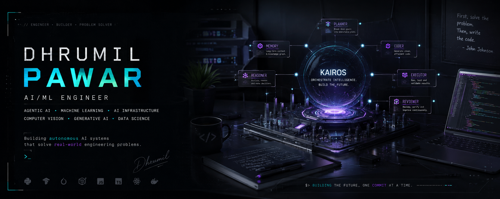

 
# Hi 👋 I'm Dhrumil Pawar

### AI/ML Engineer • Agentic AI • AI Infrastructure • Machine Learning

Building autonomous AI systems that solve real-world engineering problems.

---

# 🚀 About Me

I build intelligent AI systems that go beyond prompt-response interactions.

My work focuses on designing **Agentic AI**, **AI Infrastructure**, **Machine Learning**, **Deep Learning**, **Computer Vision**, and **Generative AI** systems capable of autonomous reasoning, orchestration, and production deployment.

Currently working as an **AI/ML Engineer @ WhiskrCode**, where I develop production AI solutions across Computer Vision, AI Agents, and LLM-powered applications.

---

# 🌟 Flagship Project

## KAIROS

> Autonomous AI Engineering Platform

KAIROS is a production-oriented AI platform that automates software engineering through specialized AI agents.

### Core Capabilities

- Multi-Agent Architecture
- Autonomous Planning
- AI Code Generation
- AI Code Review
- AI Testing
- Long-Term Memory
- Context Management
- Secure Sandboxed Execution
- Desktop Automation
- Multi-LLM Provider Support
- Cross-Platform Desktop Application

---

# 🎯 Current Focus

- Agentic AI
- Multi-Agent Systems
- AI Infrastructure
- Machine Learning
- Deep Learning
- Computer Vision
- Production AI Systems
- MLOps

---

# ⚡ Technical Expertise

### AI & Machine Learning

Machine Learning • Deep Learning • NLP • Computer Vision • Time-Series • Feature Engineering • Model Evaluation

### Agentic AI

CrewAI • LangGraph • MCP • Autonomous AI Workflows • AI Orchestration

### Generative AI

OpenAI • Claude • Gemini • Ollama • RAG • Prompt Engineering

### Backend

Python • FastAPI • REST APIs

### Databases

PostgreSQL • Redis

### DevOps

Docker • GitHub Actions

---

# 🛠 Tech Stack

---

# 📌 Featured Projects

### 🚀 KAIROS

Autonomous AI Engineering Platform

---

### 🤖 NexusForge

Multi-Agent AI Platform built using CrewAI & MCP

---

### 👁 YOLOv8 Industrial Vision

Production Computer Vision Pipeline

---

### 🧠 Career AI Agent

LLM-powered Career Assistant

---

# 📊 GitHub Analytics

---

# 📈 Contribution Graph

---

# 🎤 Speaking

International AI Conference 2024

Harnessing NLP with AI

---

# 🤝 Let's Connect

I'm always interested in collaborating on

- Agentic AI
- AI Infrastructure
- Machine Learning
- Computer Vision
- Generative AI
- Open Source AI

---

⭐ Thanks for visiting my profile!

Building the future, one intelligent system at a time.

