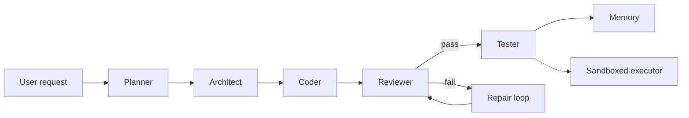
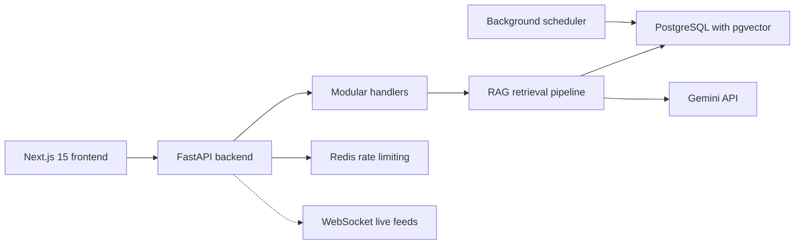

# Dhrumil Pawar

**AI/ML Engineer building agentic AI systems, computer vision pipelines and full-stack AI products.**

1+ year of professional experience. Currently at WhiskrCode (remote), delivering a real-time YOLOv8 industrial computer vision pipeline, from dataset annotation and model training to a deployed desktop application.

[LinkedIn](https://www.linkedin.com/in/dhrumil-pawar/) | [Portfolio](https://www.datascienceportfol.io/dhrumilpawar) | [Email](mailto:dhrumilpawar2910@gmail.com)

| | |
|---|---|
| Current role | AI/ML Engineer, WhiskrCode (remote) |
| Focus | Agentic AI, computer vision, generative AI |
| Building | KAIROS V1 (autonomous AI engineering platform) and AI IntelHub (AI intelligence SaaS) |
| Target roles | Agentic AI Engineer, AI/ML Engineer, GenAI Engineer, Computer Vision Engineer |
| Open to | Global remote roles, full-time or contract. Visa sponsorship: UK, EU, Canada, UAE, Singapore, USA |

## Verify my work

The source code of my two main projects is private. These links show the architecture, the working product and the engineering documentation.

| Project | Evidence |
|---|---|
| KAIROS V1 | [Demo video]({{KAIROS_DEMO_URL}}) / [Architecture showcase]({{KAIROS_SHOWCASE_URL}}) |
| AI IntelHub | [Demo video]({{INTELHUB_DEMO_URL}}) / [Architecture showcase]({{INTELHUB_SHOWCASE_URL}}) |
| Agent and ML projects | Public repositories, listed under Other projects below |

<!--
Add after you measure them: YOLOv8 results (for example mAP and FPS), KAIROS task success rate, IntelHub retrieval latency.
Only add numbers you can explain and reproduce.
-->

## Experience

**AI/ML Engineer, WhiskrCode** (remote) | June 2025 to present

- Built a real-time YOLOv8 computer vision pipeline for an industrial use case: dataset preparation and annotation, model training, evaluation and deployment as a desktop application.
- Built agentic AI workflows with CrewAI and LangGraph for multi-step reasoning, task orchestration and business process automation.
- Developed AI solutions across agentic AI, generative AI, machine learning and computer vision to automate business workflows.

## Selected projects

### KAIROS V1: autonomous AI engineering platform

A 5-layer engine that coordinates six specialized agents to plan, generate, review, repair and test complete codebases, delivered as a standalone cross-platform desktop application.

| Subsystem | What it does |
|---|---|
| Six-agent pipeline | Planner, Architect, Coder, Reviewer, Tester and Memory agents run in strict sequence |
| Self-healing repair loop | When review fails, it builds a fix plan and re-runs the reviewer without human input |
| Deterministic blueprints | Framework templates keep project structure identical on every run instead of leaving layout to the LLM |
| Multi-provider LLM routing | OpenAI, Claude, Gemini, Ollama and NVIDIA behind one provider abstraction |
| Sandboxed execution | Generated code runs in isolated subprocesses with a 30-second timeout and stderr capture |
| Desktop automation | PyAutoGUI, PyGetWindow and Playwright for window, mouse, keyboard and browser control |
| Packaging | Standalone cross-platform app built with PyQt6 and PyInstaller |
| Engineering documentation | 47-page design document with architecture decision records, a threat model and 18 architecture diagrams |

**Stack:** Python, LangGraph, CrewAI, MCP, OpenAI, Claude, Gemini, Ollama, NVIDIA, PyQt6, Playwright, PyAutoGUI, FastAPI, Docker, SQLite

### AI IntelHub: AI intelligence SaaS

A full-stack platform that aggregates AI news, startup funding intelligence, model releases, framework updates and research trends, with semantic search powered by RAG. Status: working product under active development.

- **Retrieval:** RAG with pgvector inside PostgreSQL, which avoids running a separate vector database service.
- **Authentication:** email, phone OTP (Firebase) and Google OAuth sign-in with JWT sessions, plus Redis-based rate limiting.
- **Billing:** Razorpay subscriptions, invoice generation, plan management and usage restrictions.
- **Real time:** WebSocket infrastructure for live news feeds and dashboard synchronization.
- **Architecture:** modular handlers replace a monolithic chatbot design, so features stay isolated and easier to extend.
- **Ingestion:** a background scheduler runs the automated intelligence ingestion pipeline and embedding generation.

**Stack:** Python, FastAPI, Next.js 15, TypeScript, PostgreSQL, pgvector, Redis, Docker, Gemini API, Firebase, Razorpay, SQLAlchemy, Alembic, Tailwind CSS, shadcn/ui, Playwright

<!--
Uncomment when the repository is public and has real results.

### Breaking Change Radar: open-source GitHub App (in development)

A GitHub App that tells developers what a dependency upgrade will break in their repository, before they upgrade, with official evidence for every finding.
Benchmark results and a live demo will be published here.
-->

## How I build

- **Keep AI where it helps and code where it is exact.** Deterministic blueprints and sandboxed execution in KAIROS exist so results are repeatable and failures are contained.
- **Choose simple infrastructure first.** pgvector inside PostgreSQL instead of a separate vector service in AI IntelHub.
- **Isolate features.** Modular handlers instead of one monolithic assistant.
- **Write the design down.** Architecture decision records, a threat model and diagrams for KAIROS.

## Other projects

Agent and machine learning projects (public repositories)

 

- [Travel Planner AI Agent](https://github.com/dhrumil1128/Travel-Planner-AI-Agent-v2.0): a multi-step autonomous trip planner that reasons over location data, photos and activities. LangGraph, Gemini Pro, Streamlit, REST APIs.
- [AutoML Agent](https://github.com/dhrumil1128/AutoML-Agent): an agent that generates end-to-end ML pipelines from natural language instructions, covering feature engineering, model selection, training and evaluation. LangGraph, LLMs, Pandas, scikit-learn.
- [Smart AI Traffic Management System](https://github.com/dhrumil1128/Smart-AI-Traffic-Managment-System-): ML-driven dynamic traffic signal control with emergency vehicle routing. Flask, Gemini Pro, scikit-learn, NetworkX, Leaflet.js.

## Skills

| Area | Technologies |
|---|---|
| Agentic AI and LLMs | LangGraph, CrewAI, MCP, RAG, OpenAI, Claude, Gemini, Ollama, NVIDIA, Mistral 7B |
| Computer vision and ML | YOLOv8, PyTorch, TensorFlow, scikit-learn, OpenCV, Hugging Face |
| Backend | Python, FastAPI, Flask, SQLAlchemy, Alembic, PostgreSQL, pgvector, Redis, WebSockets |
| Frontend and desktop | Next.js, TypeScript, Tailwind CSS, shadcn/ui, PyQt6, Streamlit |
| Automation | Playwright, PyAutoGUI |
| DevOps and cloud | Docker, GitHub Actions, AWS |

## Talk and education

- Speaker: "Harnessing NLP with AI", International AI Conference, 2024.
- B.Tech in Computer Science Engineering, ITM (SLS) Baroda University, 2021 to 2025. CGPA 8.7/10.

## Contact

I am open to global remote roles, full-time or contract, in agentic AI, AI/ML, generative AI and computer vision.

Email: [dhrumilpawar2910@gmail.com](mailto:dhrumilpawar2910@gmail.com) | [LinkedIn](https://www.linkedin.com/in/dhrumil-pawar/) | [Portfolio](https://www.datascienceportfol.io/dhrumilpawar)
